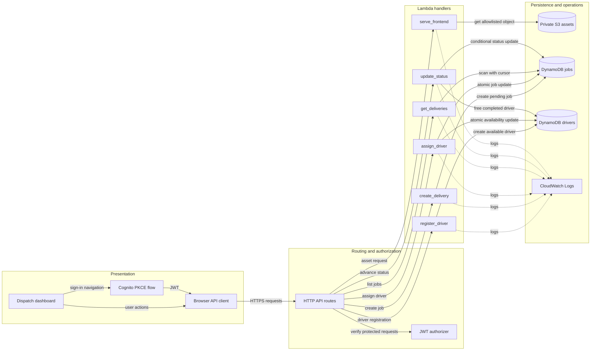
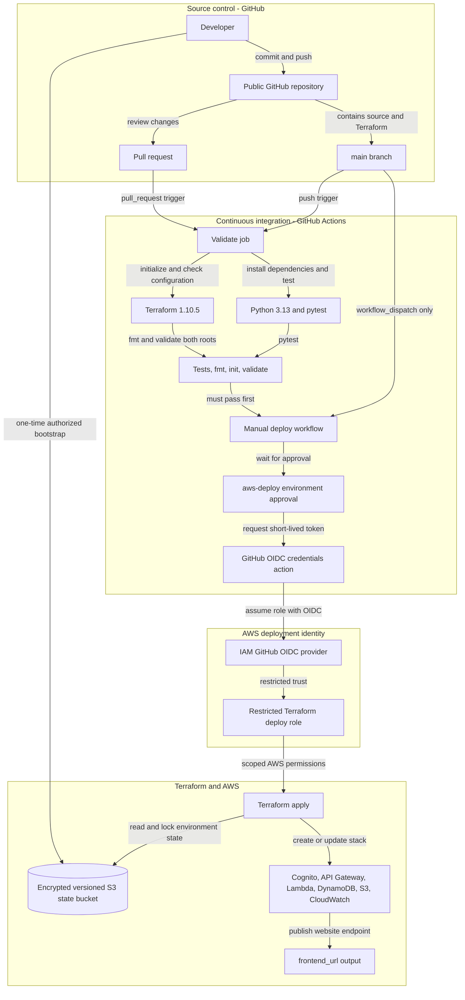

# Architecture Diagram

This document shows the deployed AWS services, how application components communicate, and how GitHub Actions and Terraform validate and deploy the project.

The visual diagrams, styled after the supplied reference, are available as [AWS runtime](../../../../../docs/architecture/aws-runtime.svg) and [DevOps pipeline](../../../../../docs/architecture/devops-pipeline.svg) SVGs.

## Application Architecture

```mermaid
flowchart TD
    subgraph ClientLayer["Client Layer"]
        UserBrowser["Web browser"]
    end
    subgraph IdentityLayer["Identity Layer"]
        UserPool["Amazon Cognito user pool"]
        JwtCheck["API Gateway JWT authorizer"]
    end
    subgraph ApiLayer["API Layer"]
        HttpApi["Amazon API Gateway HTTP API"]
    end
    subgraph ComputeLayer["Compute Layer - AWS Lambda"]
        PageHandler["serve_frontend"]
        DriverHandler["register_driver"]
        CreateHandler["create_delivery"]
        AssignHandler["assign_driver"]
        ListHandler["get_deliveries"]
        StatusHandler["update_status"]
        LambdaRole["Lambda execution role"]
    end
    subgraph StorageLayer["Storage Layer"]
        FrontendBucket[("Private Amazon S3 frontend bucket")]
        JobsTable[("Amazon DynamoDB jobs table")]
        DriversTable[("Amazon DynamoDB drivers table")]
    end
    subgraph ObservabilityLayer["Observability"]
        CloudWatch["Amazon CloudWatch Logs"]
    end

    UserBrowser -->|"HTTPS page and API requests"| HttpApi
    UserBrowser -->|"PKCE sign-in and sign-up"| UserPool
    UserPool -->|"authorization code and JWT"| UserBrowser
    HttpApi -->|"public asset routes"| PageHandler
    PageHandler -->|"read static files and config"| FrontendBucket
    HttpApi -->|"validate bearer JWT"| JwtCheck
    JwtCheck -->|"issuer and audience keys"| UserPool
    HttpApi -->|"POST drivers"| DriverHandler
    HttpApi -->|"POST deliveries"| CreateHandler
    HttpApi -->|"POST assign"| AssignHandler
    HttpApi -->|"GET deliveries"| ListHandler
    HttpApi -->|"PATCH status"| StatusHandler
    DriverHandler -->|"conditional put"| DriversTable
    CreateHandler -->|"conditional put"| JobsTable
    AssignHandler -->|"atomic transaction"| JobsTable
    AssignHandler -->|"atomic transaction"| DriversTable
    ListHandler -->|"paginated scan"| JobsTable
    StatusHandler -->|"conditional update or transaction"| JobsTable
    StatusHandler -->|"release driver on completion"| DriversTable
    LambdaRole -.->|"scoped access"| JobsTable
    LambdaRole -.->|"scoped access"| DriversTable
    LambdaRole -.->|"read objects"| FrontendBucket
    DriverHandler -->|"application logs"| CloudWatch
    CreateHandler -->|"application logs"| CloudWatch
    AssignHandler -->|"application logs"| CloudWatch
    ListHandler -->|"application logs"| CloudWatch
    StatusHandler -->|"application logs"| CloudWatch
    PageHandler -->|"application logs"| CloudWatch
    HttpApi -->|"access logs"| CloudWatch
```

<!-- mermaid-checked: no \n, no em-dash/en-dash, no {} in labels, subgraphs are id["label"], arrows are -->|"label"|, all subgraphs closed by end, ids unique -->

### Technology Stack Summary

| Layer | Technology | Version | Purpose |
| --- | --- | --- | --- |
| User interface | HTML, CSS, browser JavaScript | Browser native | Dispatch dashboard, forms, filters, and status actions |
| Authentication | Amazon Cognito user pool | AWS managed | Email sign-up/sign-in and JWT issuance using OAuth authorization code with PKCE |
| API | Amazon API Gateway HTTP API | AWS managed | HTTPS website asset routes and protected application endpoints |
| Compute | AWS Lambda with Python | Python 3.13 | Serve frontend assets and run delivery and driver handlers |
| Database | Amazon DynamoDB | On-demand | Store jobs and drivers with encryption and point-in-time recovery |
| Static asset storage | Amazon S3 | AWS managed | Keep frontend files private and encrypted at rest |
| Logging | Amazon CloudWatch Logs | AWS managed | Retain API access and Lambda application logs |
| Infrastructure as code | Terraform | 1.10.5 in CI; minimum 1.10 | Provision and update AWS resources |
| Terraform providers | HashiCorp AWS and Archive | 5.100.0 and 2.8.1 | Manage AWS resources and package Lambda code |
| CI/CD | GitHub Actions | Hosted runner | Run tests and Terraform validation; manually deploy through protected environment and OIDC |
| Tests | pytest | 9.2.0 | Run mock-based tests without writing to AWS |

### Data Storage & External Services

Delivery jobs and drivers are stored in separate on-demand DynamoDB tables. The browser never accesses DynamoDB directly: it obtains Cognito tokens and sends API requests through API Gateway. Public page routes call a small Lambda that reads allowlisted assets from a private S3 bucket; delivery and driver routes require a Cognito JWT. Lambda and API access logs go to CloudWatch Logs. CloudFront is not part of the deployed path because the AWS account could not create distributions; API Gateway currently serves the page over HTTPS.

### Key Architectural Decisions

- Driver assignment updates the job and driver atomically; delivery completion updates the job and frees the driver atomically.
- Public routes are limited to the webpage assets and runtime config; business API routes use a Cognito JWT authorizer.
- Terraform state is stored in a separate versioned, encrypted S3 bucket with native state locking. The bootstrap stack is run once before app deployment.
- GitHub Actions validates pull requests and pushes to `main`; AWS deployment is a manual `workflow_dispatch` from `main` behind the `aws-deploy` environment. GitHub assumes an externally configured IAM role using OIDC rather than stored AWS keys.

## Component Relationships

<!-- mermaid-checked: no \n, no em-dash/en-dash, no {} in labels, subgraphs are id["label"], arrows are -->|"label"|, all subgraphs closed by end, ids unique -->

### Component Inventory

| Component | Layer | Type | Responsibility |
| --- | --- | --- | --- |
| Dispatch dashboard | Presentation | Static webpage | Displays delivery queue, filters, metrics, and create forms |
| Cognito PKCE flow | Presentation | Browser authentication | Signs users in and obtains JWTs without a client secret |
| Browser API client | Presentation | JavaScript client | Sends authorized requests and renders API results |
| HTTP API routes | Routing | API Gateway | Routes asset requests and delivery operations to Lambda |
| JWT authorizer | Routing | API Gateway authorizer | Validates Cognito issuer and app-client audience |
| serve_frontend | Handler | AWS Lambda | Reads allowlisted frontend objects from S3 |
| register_driver | Handler | AWS Lambda | Creates a driver with AVAILABLE status |
| create_delivery | Handler | AWS Lambda | Creates a PENDING delivery job |
| assign_driver | Handler | AWS Lambda | Atomically assigns an available driver to a pending job |
| get_deliveries | Handler | AWS Lambda | Returns a bounded page of delivery records |
| update_status | Handler | AWS Lambda | Enforces status transitions and releases a driver on completion |
| Jobs table | Data | DynamoDB table | Stores customer delivery and status records |
| Drivers table | Data | DynamoDB table | Stores driver details and availability |
| Frontend bucket | Data | Private S3 bucket | Stores HTML, CSS, JavaScript, and generated runtime config |
| CloudWatch Logs | Operations | Managed logging | Stores API access and Lambda application logs |

## DevOps Architecture

<!-- mermaid-checked: no \n, no em-dash/en-dash, no {} in labels, subgraphs are id["label"], arrows are -->|"label"|, all subgraphs closed by end, ids unique -->

### DevOps Tool Inventory

| Tool | Used for | Connection |
| --- | --- | --- |
| Git and GitHub | Source history, pull requests, and `main` branch | Pushes and pull requests trigger validation |
| GitHub Actions | CI and protected manual deployment | Runs unit tests and Terraform checks; deploys only on manual dispatch from `main` |
| Python 3.13 and pytest | Backend test environment | Runs the mock-based suite without modifying AWS data |
| Terraform 1.10.5 | Infrastructure validation and deployment | Uses pinned AWS and Archive providers and maintains remote state in S3 |
| GitHub Actions OIDC | Short-lived AWS authentication | Assumes the restricted IAM deployment role; no long-lived AWS keys are stored in GitHub |
| GitHub environment | Deployment approval gate | Protects the `aws-deploy` workflow before AWS changes |
| AWS IAM Identity Center profile | One-time local bootstrap | Authorized local identity creates the state bucket before GitHub deployment is configured |
| Amazon S3 state backend | Remote Terraform state and lock file | Stores separate `dev` and `prod` state keys |

The OIDC provider, deploy role, GitHub environment variables, and role secret are prerequisites configured outside this Terraform stack. The one-time bootstrap creates the protected state bucket; afterward GitHub Actions can apply the application stack using short-lived credentials.